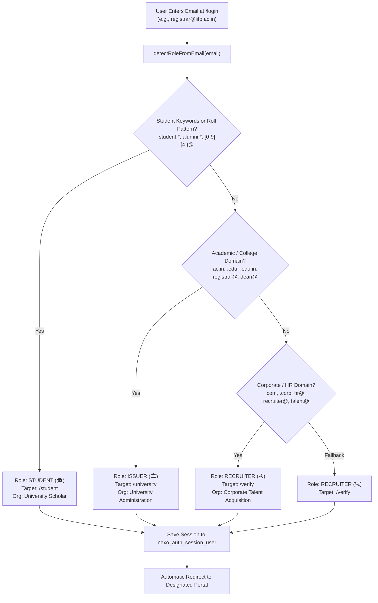
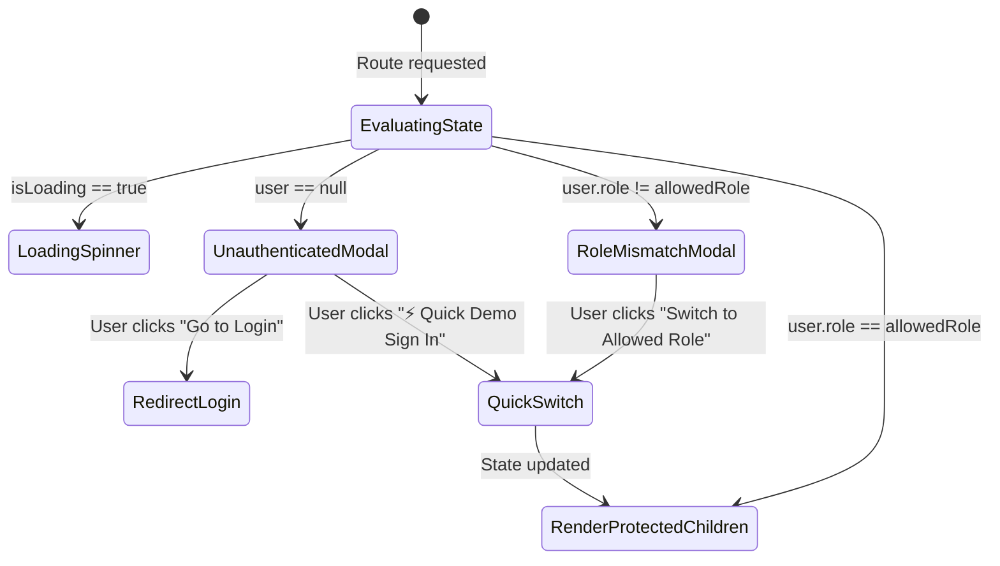
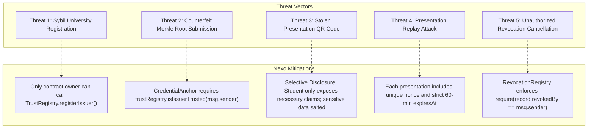

# 🔐 Authentication & Role-Based Access Control (RBAC)
## Identity Heuristics, Session Management & Security Architecture

---

## 1. Authentication Philosophy

Nexo eliminates traditional Web3 wallet connect barriers and cumbersome passwords by introducing an **Intelligent Domain-Based Role Detection Engine** (`src/lib/auth.ts`). 

### Core Design Principles:
1. **Zero MetaMask Barrier**: Users don't need browser extensions or crypto knowledge to authenticate.
2. **Deterministic Role Heuristics**: Users are assigned to their designated portal automatically based on their institutional or corporate email domain.
3. **Explicit Route Protection**: Next.js client-side route guards prevent role escalation and access leakage.
4. **1-Click Demo Personas**: Pre-configured institutional identities for seamless evaluation.



---

## 2. Real-Time Domain Detection Rules

The detection algorithm inspects both the **username** and the **domain** portions of the input email:

### Rule 1: Student / Alumni Detection (`STUDENT`)
Matches if:
- Username contains `student`, `alumni`, or begins with an enrollment roll number (e.g. `2024101@...`).
- Domain contains `student.` or starts with `std.` or `mail.`.
- **Target Portal**: `/student`
- **Icon**: 🎓

### Rule 2: College / University Admin Detection (`ISSUER`)
Matches if:
- Domain ends with `.edu`, `.ac.in`, `.edu.in`, `.org.in`.
- Domain contains institution names (e.g. `iit`, `nit`, `bits`, `university`, `college`).
- Username denotes administrative office (`registrar`, `examcell`, `dean`, `admin`).
- **Target Portal**: `/university`
- **Icon**: 🏛️

### Rule 3: Corporate Recruiter / Background Verifier (`RECRUITER`)
Matches if:
- Domain ends with standard corporate TLDs (`.com`, `.corp`, `.io`, `.tech`, `.co`).
- Username denotes talent acquisition (`recruiter`, `hr`, `talent`, `hiring`).
- **Target Portal**: `/verify`
- **Icon**: 🔍

---

## 3. Role-Based Access Control (RBAC) Matrix

| Portal Page | Route | Allowed Role | Non-Permitted Roles Behavior |
| :--- | :--- | :---: | :--- |
| **Landing Page** | `/` | **ALL** | Renders role status banner with direct portal link if authenticated. |
| **Sign-In / Auth** | `/login` | **ALL** | Real-time domain badge updates as user types; offers 1-click demo presets. |
| **Issuer Portal** | `/university` | `ISSUER` | Blocked by `AuthGuard`: Renders Red Access Mismatch alert with switch button. |
| **Student Wallet** | `/student` | `STUDENT` | Blocked by `AuthGuard`: Prompts student email login. |
| **Recruiter Verifier** | `/verify` | `RECRUITER` | Blocked by `AuthGuard`: Prompts corporate reviewer email login. |

### Permissions by Feature
| Capability | `ISSUER` (College) | `STUDENT` (Holder) | `RECRUITER` (Reviewer) |
| :--- | :---: | :---: | :---: |
| Upload & parse graduation CSV batches | ✅ | ❌ | ❌ |
| Submit Merkle anchor tx to Polygon Amoy | ✅ | ❌ | ❌ |
| Trigger on-chain degree revocation | ✅ | ❌ | ❌ |
| Generate in-app encrypted Web3 keypair | ❌ | ✅ | ❌ |
| View & manage private credential portfolio | ❌ | ✅ | ❌ |
| Selectively disclose claims & generate QR | ❌ | ✅ | ❌ |
| Scan & decode candidate QR codes | ❌ | ❌ | ✅ |
| Execute 5-step on-chain verification pipeline | ❌ | ❌ | ✅ |
| Inspect public TrustRegistry & Revocations | ✅ | ✅ | ✅ |

---

## 4. `AuthGuard` Component Architecture (`src/components/auth/AuthGuard.tsx`)

Every protected route is wrapped in an `<AuthGuard allowedRole="...">` component that evaluates state in real time:



### Protection States Handled:
1. **Unauthenticated User (`user == null`)**:
   - Displays clean informational modal explaining authentication requirements.
   - Shows specific authorization badge (e.g. *"Requires College / University Institutional Email"*).
   - Provides 1-click demo bypass shortcut (`quickLoginPreset(allowedRole)`).
2. **Role Mismatch (`user.role !== allowedRole`)**:
   - Displays explicit access restriction card detailing current active identity.
   - Explains why the current role cannot access this portal (e.g., *Students cannot access the University Minting Portal*).
   - Offers 1-click button to redirect to their own portal or switch roles.

---

## 5. Security & Threat Modeling



### Detailed Threat Analysis

#### 1. Sybil / Rogue Issuer Attack
- **Vector**: A malicious actor sets up an Ethereum wallet and attempts to anchor fake degrees for candidates.
- **Defense**: `CredentialAnchor.sol` invokes `trustRegistry.isIssuerTrusted(msg.sender)`. If the address is not registered on the official `TrustRegistry`, the transaction reverts. Recruiter verification additionally checks `TrustRegistry.isIssuerTrusted(issuerAddress)`; if false, it triggers an immediate **Untrusted Issuer** red alert.

#### 2. Replay & Token Interception Attacks
- **Vector**: A recruiter or eavesdropper captures a candidate's presentation QR token and reuses it months later to impersonate the candidate.
- **Defense**:
  1. Every `VerificationPresentationPayload` incorporates an `expiresAt` timestamp (default: 60 minutes) and an 8-byte cryptographic `nonce`.
  2. Verifier Step 1 asserts: `new Date(presentation.expiresAt).getTime() > Date.now()`. Expired presentations display an amber alert and are marked invalid.

#### 3. Unauthorized Revocation / Malicious Restoration
- **Vector**: An employer or university administrator attempts to undo a degree revocation executed by another university.
- **Defense**: `RevocationRegistry.sol` enforces:
  ```solidity
  require(record.revokedBy == msg.sender, "Only the revoking issuer can cancel revocation");
  ```
  Only the specific address that initiated the revocation can ever cancel it.

---

## 6. Privacy & Regulatory Compliance

### 6.1 Digital Personal Data Protection (DPDP) Act 2023 (India)
- **Data Minimization (Section 6)**: Candidates disclose only necessary qualification attributes (e.g., *"CGPA $\ge$ 8.0: true"*) instead of exposing 4 years of marks and home addresses.
- **Purpose Limitation (Section 7)**: Every generated presentation embeds an explicit `purpose` string (e.g., *"Employment Verification for Google India"*).
- **Consent Tracking**: The student in-app wallet maintains an immutable audit trail (`nexo_consent_logs`) detailing every third party granted access.

### 6.2 GDPR Article 5 Compliance
- **Right to be Forgotten**: Zero PII is committed to the blockchain. If a student exercises their right to erasure, off-chain records can be deleted without violating blockchain immutability, as only salted hash digests exist on-chain.
