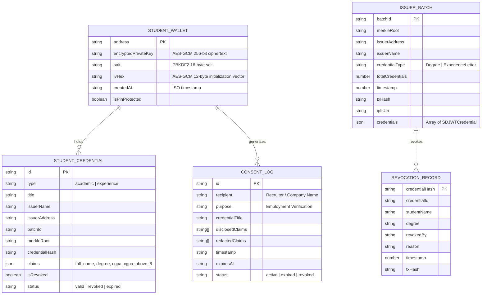
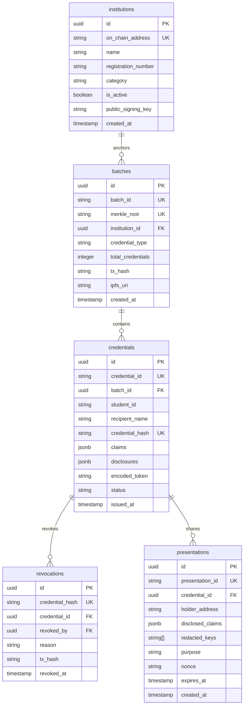

# 🗄️ Database, Storage & Schema Architecture
## Data Structures, Storage Layouts & Schemas

---

## 1. Data Architecture Overview

Nexo follows a **decentralized, privacy-preserving hybrid storage strategy**:
1. **On-Chain Storage (Polygon Amoy)**: Only stores 32-byte cryptographic hashes, batch Merkle roots, issuer public keys, and revocation flags. Zero plaintext PII ever touches the public blockchain.
2. **Client-Side Storage (`localStorage` / `sessionStorage`)**: Encrypted student private keys, credential portfolios, consent audit logs, and issued batch manifests.
3. **Serverless In-Memory Presentation Store**: Ephemeral maps serving active QR verification presentations with automated expiration.
4. **Production Relational Schema (PostgreSQL)**: Architecture blueprint for enterprise institutional scaling.

---

## 2. On-Chain Storage Layout (Solidity State)

### 2.1 `TrustRegistry.sol`
| Variable / Mapping | Solidity Type | Visibility | Description |
| :--- | :--- | :--- | :--- |
| `_issuers` | `mapping(address => IssuerInfo)` | `private` | Maps institution address to name, category, status, and signing key |
| `_issuerList` | `address[]` | `private` | Dynamic array for enumerable iteration of all registered institutions |

### 2.2 `CredentialAnchor.sol`
| Variable / Mapping | Solidity Type | Visibility | Description |
| :--- | :--- | :--- | :--- |
| `trustRegistry` | `TrustRegistry` | `public immutable` | Reference to the authoritative trust contract |
| `_batches` | `mapping(bytes32 => BatchRecord)` | `private` | Maps unique `batchId` to Merkle root, IPFS URI, and count |
| `_rootToBatch` | `mapping(bytes32 => bytes32)` | `private` | Lookup table mapping `merkleRoot => batchId` for instant deduplication |

### 2.3 `RevocationRegistry.sol`
| Variable / Mapping | Solidity Type | Visibility | Description |
| :--- | :--- | :--- | :--- |
| `trustRegistry` | `TrustRegistry` | `public immutable` | Reference to the authoritative trust contract |
| `_revocations` | `mapping(bytes32 => RevocationRecord)` | `private` | Maps `credentialHash => RevocationRecord` |

---

## 3. Client-Side Browser Storage (`localStorage` & `sessionStorage`)

Nexo leverages client storage to achieve zero-friction, gasless identity management without requiring centralized accounts:



### Storage Key Registry
| Storage Medium | Key Name | Purpose | Security Level |
| :--- | :--- | :--- | :--- |
| `localStorage` | `nexo_student_wallet` | Encrypted wallet keypair and encryption metadata | **High**: Encrypted via AES-GCM; requires PIN |
| `sessionStorage` | `nexo_student_active_key` | Unlocked decrypted private key in active memory | **Medium**: Cleared automatically upon tab close |
| `localStorage` | `nexo_student_credentials` | Student's portfolio of academic degrees & letters | Plaintext JSON cache |
| `localStorage` | `nexo_consent_logs` | Audit trail of selective disclosures shared with HRs | Plaintext JSON log |
| `localStorage` | `nexo_issuer_batches` | Manifest of all batches anchored by university | Plaintext JSON log |
| `localStorage` | `nexo_revocations` | Local index of credentials revoked by institution | Plaintext JSON log |
| `localStorage` | `nexo_auth_session_user` | Currently signed-in user session & detected role | Plaintext JSON cache |
| `localStorage` | `nexo_pres_<id>` | Offline presentation payload fallback for QR scanner | Plaintext JSON cache |

---

## 4. Ingestion Data Schemas (CSV & ERP)

### 4.1 University Students Batch Schema (`sample_students_batch.csv`)
Used in **Module 2: Bulk Issuance** for graduating cohorts.

| Column | Type | Required | Description | Example |
| :--- | :--- | :--- | :--- | :--- |
| `student_id` | String | Yes | Unique university roll or matriculation number | `IITB-2024-001` |
| `full_name` | String | Yes | Candidate full legal name | `Aarav Sharma` |
| `degree` | String | Yes | Degree title awarded | `Bachelor of Technology` |
| `major` | String | Yes | Academic discipline or department | `Computer Science and Engineering` |
| `graduation_year`| Integer| Yes | 4-digit convocation year (1970–2035) | `2024` |
| `cgpa` | Float | Yes | Cumulative Grade Point Average (0.00–10.00) | `8.85` |
| `cgpa_above_8` | Boolean| Auto | Predicate proof generated automatically if `cgpa >= 8.0` | `true` |
| `institution_name`| String| Yes | Official name of issuing university | `IIT Bombay` |
| `issue_date` | Date | Yes | Date of certificate issuance (YYYY-MM-DD) | `2024-06-15` |

### 4.2 Corporate Experience Letters Schema (`sample_experience_letters.csv`)
Used for corporate relieving certificates.

| Column | Type | Required | Description | Example |
| :--- | :--- | :--- | :--- | :--- |
| `employee_id` | String | Yes | Corporate employee / payroll ID | `EMP-TCS-1092` |
| `employee_name` | String | Yes | Full name of departing employee | `Aarav Sharma` |
| `company_name` | String | Yes | Name of employer | `Tata Consultancy Services` |
| `designation` | String | Yes | Final job designation held | `Senior Systems Engineer` |
| `department` | String | No | Business unit / corporate department | `Cloud & Infrastructure` |
| `start_date` | Date | Yes | Date employment commenced (YYYY-MM-DD) | `2021-08-01` |
| `end_date` | Date | Yes | Official last working day / relieving date | `2024-04-30` |
| `experience_years`| Float | Yes | Total calculated service tenure | `2.75` |
| `conduct_rating` | String | No | HR exit rating assessment | `Exemplary` |

---

## 5. Enterprise Relational Database Blueprint (PostgreSQL / Prisma)

For enterprise institutions seeking a persistent server-side relational database backing the Nexo platform, the following schema is specified:



### PostgreSQL DDL Definitions
```sql
CREATE TYPE issuer_category AS ENUM ('University', 'Employer', 'CertificationBody');
CREATE TYPE credential_status AS ENUM ('ACTIVE', 'REVOKED', 'EXPIRED');

CREATE TABLE institutions (
    id UUID PRIMARY KEY DEFAULT gen_random_uuid(),
    on_chain_address VARCHAR(42) UNIQUE NOT NULL,
    name VARCHAR(255) NOT NULL,
    registration_number VARCHAR(100) NOT NULL,
    category issuer_category NOT NULL,
    is_active BOOLEAN DEFAULT TRUE,
    public_signing_key VARCHAR(42) NOT NULL,
    created_at TIMESTAMP WITH TIME ZONE DEFAULT CURRENT_TIMESTAMP
);

CREATE TABLE batches (
    id UUID PRIMARY KEY DEFAULT gen_random_uuid(),
    batch_id VARCHAR(66) UNIQUE NOT NULL,
    merkle_root VARCHAR(66) UNIQUE NOT NULL,
    institution_id UUID REFERENCES institutions(id) ON DELETE RESTRICT,
    credential_type VARCHAR(50) NOT NULL,
    total_credentials INTEGER NOT NULL,
    tx_hash VARCHAR(66) NOT NULL,
    ipfs_uri TEXT NOT NULL,
    created_at TIMESTAMP WITH TIME ZONE DEFAULT CURRENT_TIMESTAMP
);

CREATE TABLE credentials (
    id UUID PRIMARY KEY DEFAULT gen_random_uuid(),
    credential_id VARCHAR(100) UNIQUE NOT NULL,
    batch_id UUID REFERENCES batches(id) ON DELETE CASCADE,
    student_id VARCHAR(100) NOT NULL,
    recipient_name VARCHAR(255) NOT NULL,
    credential_hash VARCHAR(66) UNIQUE NOT NULL,
    claims JSONB NOT NULL,
    disclosures JSONB NOT NULL,
    encoded_token TEXT NOT NULL,
    status credential_status DEFAULT 'ACTIVE',
    issued_at TIMESTAMP WITH TIME ZONE DEFAULT CURRENT_TIMESTAMP
);

CREATE TABLE revocations (
    id UUID PRIMARY KEY DEFAULT gen_random_uuid(),
    credential_hash VARCHAR(66) UNIQUE NOT NULL,
    credential_id UUID REFERENCES credentials(id) ON DELETE RESTRICT,
    revoked_by UUID REFERENCES institutions(id),
    reason TEXT NOT NULL,
    tx_hash VARCHAR(66) NOT NULL,
    revoked_at TIMESTAMP WITH TIME ZONE DEFAULT CURRENT_TIMESTAMP
);

CREATE TABLE presentations (
    id UUID PRIMARY KEY DEFAULT gen_random_uuid(),
    presentation_id VARCHAR(50) UNIQUE NOT NULL,
    credential_id UUID REFERENCES credentials(id) ON DELETE CASCADE,
    holder_address VARCHAR(42) NOT NULL,
    disclosed_claims JSONB NOT NULL,
    redacted_keys TEXT[] NOT NULL,
    purpose VARCHAR(255) NOT NULL,
    nonce VARCHAR(32) NOT NULL,
    expires_at TIMESTAMP WITH TIME ZONE NOT NULL,
    created_at TIMESTAMP WITH TIME ZONE DEFAULT CURRENT_TIMESTAMP
);
```
