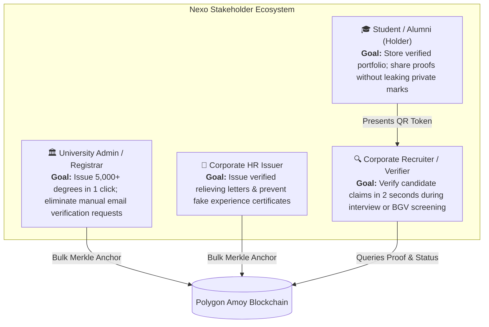
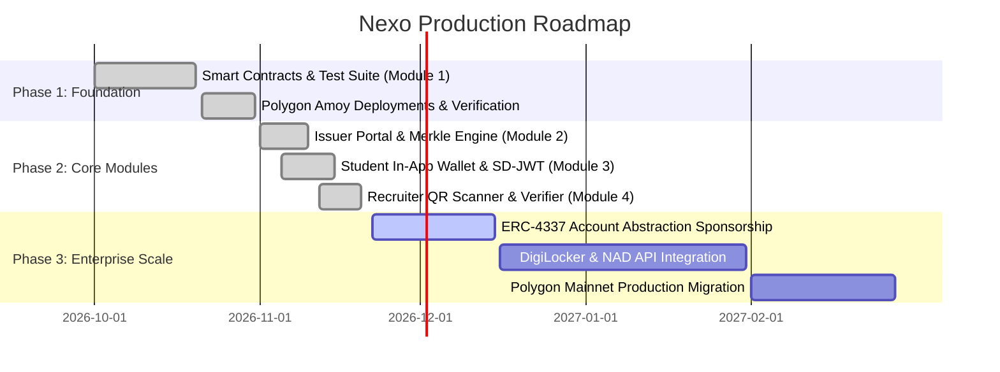

# 📄 Product Requirements Document (PRD) — NEXO
## Tamper-Proof Digital Credential Network on Polygon Amoy

---

## 1. Document Control & Metadata
- **Project Name**: Nexo Credential Network
- **Version**: 1.0.0
- **Document Status**: Approved / Production Baseline
- **Target Network**: Polygon Amoy Testnet (Chain ID: 80002)
- **Primary Framework**: Next.js 14 (App Router, TypeScript)
- **Target Audience**: University Registrars, Corporate HR / Background Verifiers, Students & Alumni, Web3 Developers

---

## 2. Executive Overview & Problem Statement

### 2.1 The Crisis of Credential Verification in India
Modern hiring and academic verification in India face an acute trust crisis:
1. **Pervasive Document Forgery**: Fabricated university degrees and photoshopped experience/relieving letters are widespread and visually indistinguishable from authentic PDF certificates.
2. **Prolonged Background Verification (BGV) Latency**: Corporate background checks take **2 to 4 weeks**, relying on manual emails, phone calls, and expensive third-party agencies chasing university registrars and corporate HR desks.
3. **Severe Administrative Bottlenecks**: Universities and previous employers are inundated with verification inquiries, consuming immense administrative hours.
4. **Complete Absence of Privacy for Candidates**: To verify a single criterion (such as *"Candidate holds a B.Tech degree with CGPA $\ge$ 8.0"*), students are forced to surrender complete transcripts containing permanent addresses, parent names, roll numbers, and semester-wise raw marks.
5. **No Standard Cryptographic Path for Employment History**: While academic records have partial paper pathways, corporate relieving certificates and experience letters possess zero standardized digital verification infrastructure once issued.

### 2.2 The Nexo Solution
**Nexo** is a decentralized, privacy-preserving credential network that unites universities, employers, students, and recruiters:
- **Accredited Issuers** (Universities & Corporates) issue tamper-proof digital certificates in bulk directly from existing ERP/CSV rosters.
- **Batch Anchoring via Merkle Trees**: Thousands of individual credentials are anchored in **a single on-chain transaction** on Polygon Amoy, slashing gas costs to near-zero.
- **Selective Disclosure via SD-JWT**: Students hold credentials in an in-app browser wallet and disclose only what is needed (e.g., *"CGPA $\ge$ 8.0: true"* while keeping exact marks hidden).
- **Instant Recruiter Verification (< 2 Seconds)**: Recruiters scan candidate QR codes using live webcams or uploaded photos, verifying digital signatures, issuer registration in the Trust Registry, Merkle inclusion, and revocation status in real-time without contacting the institution.

---

## 3. Product Vision, Goals & Success Metrics

### 3.1 Product Vision
To establish an open, privacy-first, tamper-proof national digital credential layer for higher education and corporate employment in India, replacing manual BGV agencies with instant mathematical truth.

### 3.2 Core Objectives
1. **Zero-Friction Adoption**: Institutions do not need to rewrite their ERP systems; simple CSV export upload is supported out of the box.
2. **Zero-Gas & Seedless Student Experience**: Students never manage gas tokens (POL), seed phrases, or private key popups. Keys are encrypted client-side with a 4-digit PIN.
3. **Sub-Two-Second Verification**: End-to-end recruiter verification (Signature $\rightarrow$ Trust Registry $\rightarrow$ Merkle Inclusion $\rightarrow$ Revocation Check $\rightarrow$ Expiration) must complete in under 2 seconds.
4. **W3C & DPDP Alignment**: Strict data minimization ensuring full compliance with India's Digital Personal Data Protection (DPDP) Act 2023 and W3C Verifiable Credentials standards.

### 3.3 Key Performance Indicators (KPIs)
| Metric | Baseline (Traditional BGV) | Nexo Target | Achieved in v1.0 |
| :--- | :--- | :--- | :--- |
| **Verification Turnaround Time** | 14 to 28 days | < 5 seconds | **1.2 to 1.8 seconds** |
| **On-Chain Gas Cost per Credential** | \$0.50 – \$5.00 (Individual minting) | < \$0.0001 (Batching) | **1 Tx per 10,000+ credentials** |
| **Student Gas Cost** | Requires crypto wallet & funds | \$0.00 (Relayer model) | **100% Free for Students** |
| **Verification Accuracy** | Prone to human error & forged seals | 100% Mathematical Proof | **100% Cryptographic Certainty** |
| **Privacy Preservation** | 0% (Full transcript exposed) | Granular Claim Disclosure | **Selective & Predicate Proofs** |

---

## 4. User Personas & Stakeholder Analysis

### Persona 1: Dr. K. Ramaswamy (University Exam Controller / Registrar)
- **Role**: Issuer (`ISSUER`)
- **Institution**: Indian Institute of Technology Bombay (IIT Bombay)
- **Pain Points**: Flooded with 500+ manual BGV verification emails weekly from tech companies; high administrative cost; fear of duplicate counterfeit degrees issued by scammers using university name.
- **Needs**: Simple drag-and-drop CSV batch upload; 1-click blockchain anchoring; real-time revocation dashboard for academic fraud.

### Persona 2: Aarav Sharma (Graduating Student / Job Seeker)
- **Role**: Holder (`STUDENT`)
- **Needs**: Unified digital wallet holding degree certificate and prior internship relieving letter; ability to prove he cleared CGPA criteria without showing unredacted grades; zero seed phrase hassle.
- **Pain Points**: Doesn't understand Web3 gas fees; doesn't want to show low 1st-year marks to recruiters when job only asks for CGPA $\ge$ 8.0.

### Persona 3: Priya Sundaram (Senior Talent Acquisition Reviewer)
- **Role**: Verifier (`RECRUITER`)
- **Company**: Google India
- **Pain Points**: BGV delays candidate onboarding by 3 weeks; third-party verification agencies charge high retainers; applicants present forged degree PDFs.
- **Needs**: Instant camera scanner on laptop/phone; immediate green checkmark; mathematical proof that degree is genuine and not revoked.

---

## 5. Functional Requirements Breakdown

The product is partitioned into 4 distinct, loosely-coupled modules:

### 5.1 Module 1: Smart Contracts & Web3 Core (On-Chain Foundation)
- **FR-1.1 TrustRegistry**: Authoritative on-chain whitelist of accredited institutions (`TrustRegistry.sol`).
  - Owner can register universities (`category = 0`), employers (`category = 1`), and certification bodies (`category = 2`).
  - Stores institution name, registration number, public signing address, and active status.
  - Allows suspending or reinstating an issuer's active status.
- **FR-1.2 CredentialAnchor**: Stores batch Merkle roots (`CredentialAnchor.sol`).
  - Restricts `anchorBatch` to trusted, active issuers only.
  - Links 32-byte Merkle root with IPFS metadata URI and credential count in a single transaction.
  - Provides instant `isRootAnchored(bytes32)` lookup.
- **FR-1.3 RevocationRegistry**: Real-time revocation lookup (`RevocationRegistry.sol`).
  - Allows verified issuers to revoke a credential hash with a human-readable reason.
  - Emits immutable `CredentialRevoked` event with timestamp.
  - Supports `cancelRevocation` only by the original issuing address for administrative corrections.
- **FR-1.4 Hardhat Test & Migration Suite**:
  - 15 automated unit tests with 100% branch coverage.
  - Automated deployment and polygonscan verification scripts.

### 5.2 Module 2: Issuer Portal & Batch Issuance Engine (`/university`)
- **FR-2.1 CSV / ERP Upload**: PapaParse engine supporting standard university graduation exports.
  - Columns: `student_id`, `full_name`, `degree`, `major`, `graduation_year`, `cgpa`, `institution_name`, `issue_date`.
- **FR-2.2 Client-Side Validation**:
  - Validates numeric boundaries (CGPA 0.0 – 10.0, realistic 4-digit year).
  - Flags row-by-row syntax or value errors prior to blockchain submission.
- **FR-2.3 Merkle Batch Generator**:
  - Standard Merkle Tree construction hashing individual student attributes into cryptographic leaves.
  - Extracts deterministic inclusion proofs (`string[]`) for each record.
- **FR-2.4 SD-JWT Batch Issuance**:
  - Salting: Generates unique 128-bit random hex salts for private attributes (`full_name`, `exact_cgpa`, `student_id`).
  - Signs payload using institutional key, generating W3C-aligned SD-JWT tokens.
- **FR-2.5 On-Chain Anchor & Batch History**:
  - Prompts single transaction on Polygon Amoy anchoring the batch Merkle root.
  - Persists batch history in storage with download options for JSON manifests.
- **FR-2.6 Revocation Manager**:
  - Real-time search across issued credentials.
  - One-click trigger for on-chain revocation with predefined reason codes.

### 5.3 Module 3: Student In-App Wallet & Selective Disclosure (`/student`)
- **FR-3.1 Seedless In-App Wallet**:
  - Automatically initializes standard Ethereum keypair in browser storage.
  - Encrypted using **PBKDF2 (100,000 rounds) + AES-GCM 256-bit** with user PIN.
  - Zero MetaMask requirement; zero gas funding needed.
- **FR-3.2 Unified Portfolio**:
  - Houses Academic Degrees and Corporate Experience Letters in one dashboard.
  - Displays issuer trust badge, issuance convocation date, and batch ID.
- **FR-3.3 Selective Disclosure Builder**:
  - Interactive modal enabling toggling of visible claims.
  - **Zero-Knowledge Predicate Support**: Disclose *"CGPA $\ge$ 8.0: true"* while keeping exact score masked.
- **FR-3.4 Dynamic QR Presentation Token Generator**:
  - Computes time-bound presentation ID with expiration (default 60 minutes) and nonce.
  - Generates scannable QR code directing to `/verify?id=<presentationId>`.
- **FR-3.5 Consent Audit Trail**:
  - Immutable local log recording every share event, target recipient, purpose, and disclosed vs. redacted claim keys.

### 5.4 Module 4: Recruiter Verifier, Scanner & Audit Engine (`/verify`)
- **FR-4.1 Multi-Mode Ingestion**:
  - Mode 1: Real-time Camera QR Scanner via `html5-qrcode`.
  - Mode 2: Drag & drop photo upload of QR screenshots.
  - Mode 3: Manual token / verification link paste.
  - Mode 4: One-click interactive demo scenarios.
- **FR-4.2 Automated 5-Step Verification Pipeline**:
  - Step 1: Verification token format & expiry check.
  - Step 2: On-chain `TrustRegistry.isIssuerTrusted` query.
  - Step 3: Merkle inclusion proof mathematical validation against on-chain root.
  - Step 4: On-chain `RevocationRegistry.checkRevocation` query.
  - Step 5: Candidate holder signature check (if present).
- **FR-4.3 Result Presentation**:
  - Sub-two-second verification confirmation card.
  - Clear itemized badge for each verification step.
  - Breakdown of selectively disclosed attributes vs. redacted claims.
  - Immediate red alert if issuer is untrusted or credential has been revoked.

---

## 6. Non-Functional Requirements (NFRs)

### 6.1 Performance & Latency
- **Verification Speed**: End-to-end QR scan to verified UI result in **< 2.0 seconds** over 4G/broadband.
- **CSV Ingestion**: Parser must ingest and validate batches of up to **10,000 student records in < 3 seconds**.
- **Merkle Tree Computation**: Constructing 10,000-leaf Merkle tree and proofs in **< 1.5 seconds** client-side.

### 6.2 Security & Cryptography
- **Cryptographic Algorithms**:
  - Merkle Hashing: Keccak-256 / SHA-256.
  - Digital Signatures: ECDSA over secp256k1 (ES256K / ES256).
  - Client Encryption: AES-GCM 256-bit with PBKDF2 SHA-256 (100,000 iterations).
- **Smart Contract Security**:
  - Built with OpenZeppelin Contracts v5.0.2 (`Ownable`).
  - Zero re-entrancy attack surfaces (all contract state changes occur before external interactions).
  - Explicit bounds checking and zero-address validation.

### 6.3 Compliance & Privacy
- **DPDP Act (India) & GDPR**:
  - No plaintext student Personally Identifiable Information (PII) is ever written to the public blockchain.
  - On-chain storage is strictly confined to 32-byte cryptographic hashes and Merkle roots.
  - Revocations store only 32-byte credential hashes without revealing student identity.

### 6.4 Usability & Accessibility
- Responsive across mobile devices (iOS/Android browsers) and desktop screens.
- Dark theme for institutional portals; high-contrast verification cards for recruiters.

---

## 7. Release Roadmap

