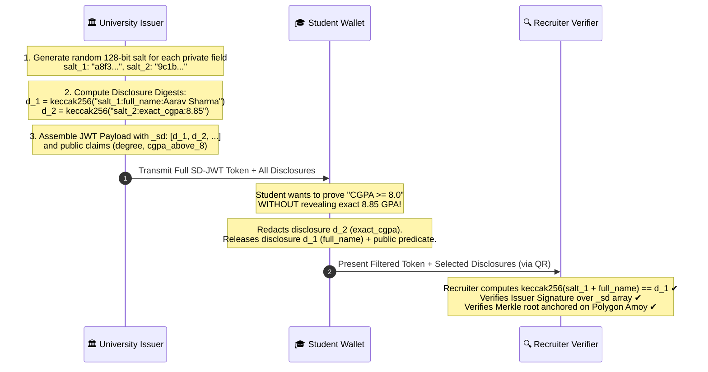
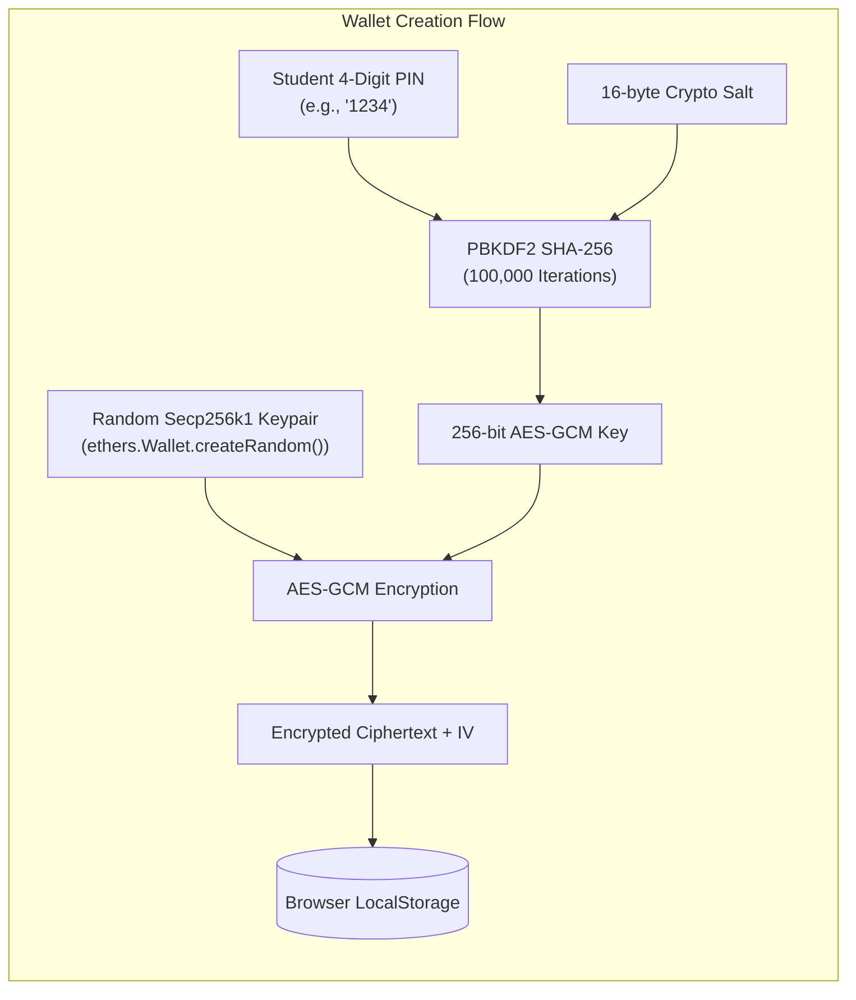
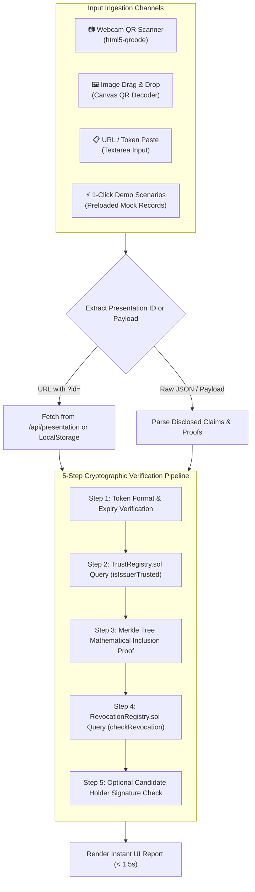
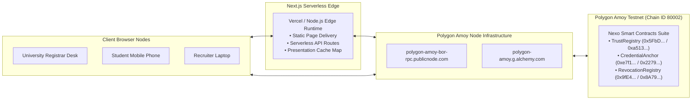

# 🏗️ System & Technical Architecture Document
## Nexo Cryptographic & Multi-Tier Architecture

---

## 1. High-Level Architecture Overview

Nexo is structured as a **privacy-first, four-tier hybrid decentralized architecture** uniting off-chain selective disclosure with on-chain cryptographic anchoring on Polygon Amoy.

```mermaid
flowchart TD
    subgraph ClientLayer["1. Client Application Layer (Next.js 14 / TypeScript)"]
        UI_Issuer["🏛️ University / Employer Portal<br/>(/university)"]
        UI_Wallet["🎓 Student In-App Wallet<br/>(/student)"]
        UI_Verifier["🔍 Recruiter Scanner & Verifier<br/>(/verify)"]
        UI_Login["🔐 Domain-Based Auth System<br/>(/login)"]
    end

    subgraph CryptoLayer["2. Cryptographic Engine Layer"]
        MerkleEngine["🌳 Merkle Tree Builder<br/>(@openzeppelin/merkle-tree)<br/>• StandardMerkleTree<br/>• Keccak-256 Leaf Hashing"]
        SDJWTEngine["📜 SD-JWT Cryptographic Engine<br/>(@sd-jwt/core)<br/>• 128-bit Salt Generation<br/>• Selective Disclosures (_sd)<br/>• Predicate Disclosures"]
        ClientWallet["🔑 Web Crypto Client Wallet<br/>• PBKDF2 (100k rounds)<br/>• AES-GCM 256-bit<br/>• Secp256k1 Keypair"]
        QRScanner["📷 QR Scanner Engine<br/>• html5-qrcode<br/>• Canvas Image Decoder<br/>• URL / ID Resolver"]
    end

    subgraph ServiceLayer["3. Next.js Serverless API & Relayer Layer"]
        API_Creds["/api/credentials<br/>Batch & Student Query"]
        API_Pres["/api/presentation<br/>In-Memory / Local Cache"]
        API_Consent["/api/student/consent<br/>Audit Trail Logger"]
        Relayer["⚡ Backend Gasless Relayer<br/>(ethers.js JsonRpcProvider)<br/>• Pays gas on behalf of students<br/>• Fallback Mock Engine"]
    end

    subgraph BlockchainLayer["4. Polygon Amoy Blockchain Layer (Chain ID: 80002)"]
        TR["TrustRegistry.sol<br/>Authoritative Whitelist"]
        CA["CredentialAnchor.sol<br/>Merkle Root Registry"]
        RR["RevocationRegistry.sol<br/>Instant Revocation Map"]
    end

    %% Interactions
    UI_Issuer --> MerkleEngine
    UI_Issuer --> SDJWTEngine
    UI_Issuer --> CA
    UI_Issuer --> RR

    UI_Wallet --> ClientWallet
    UI_Wallet --> SDJWTEngine
    UI_Wallet --> API_Pres
    UI_Wallet --> API_Consent

    UI_Verifier --> QRScanner
    UI_Verifier --> API_Pres
    UI_Verifier --> TR
    UI_Verifier --> CA
    UI_Verifier --> RR

    Relayer --> TR
    Relayer --> CA
    Relayer --> RR
```



---

## 2. Cryptographic Deep-Dive

### 2.1 Standard Merkle Tree Construction (`src/lib/merkle.ts`)
To anchor thousands of graduation degrees or corporate relieving letters in a single 32-byte hash, Nexo employs OpenZeppelin's `StandardMerkleTree`.

#### Leaf Schema Definition
Each student record is deterministically hashed into a typed leaf according to the following schema:
```typescript
export const MERKLE_LEAF_TYPES = [
  "string",  // 1. credentialId (e.g. CRED-IITBOMBAY-2024-IITB-2024-001)
  "string",  // 2. studentId (e.g. IITB-2024-001)
  "bytes32", // 3. fullNameHash (keccak256(fullName))
  "string",  // 4. degree (e.g. Bachelor of Technology)
  "string",  // 5. major (e.g. Computer Science and Engineering)
  "uint256", // 6. graduationYear (e.g. 2024)
  "bytes32", // 7. cgpaHash (keccak256(cgpa.toFixed(2)))
  "bool",    // 8. cgpaAbove8 (derived boolean predicate)
  "string"   // 9. issueDate (YYYY-MM-DD)
];
```

#### Privacy through Double-Hashing
Notice that `fullName` and `cgpa` are pre-hashed (`fullNameHash`, `cgpaHash`) with `keccak256` before being placed into the tree leaf. This prevents rainbow table reconstruction of candidate identities even if the entire Merkle tree is inspected.

#### Proof Verification Mathematical Identity
For any leaf $L$ with proof sequence $P = [p_1, p_2, \dots, p_k]$:
$$\text{Verify}(R, L, P) \iff \text{FoldHash}(L, P) = R$$
Where $R$ is the root anchored on `CredentialAnchor.sol`. Verification takes $O(\log N)$ hash operations and executes in **< 1 millisecond** client-side.

---

### 2.2 SD-JWT (Selective Disclosure JWT) Architecture (`src/lib/sdjwt.ts`)
Nexo aligns with the **IETF SD-JWT & W3C Verifiable Credentials** specifications. Traditional JWTs force all-or-nothing disclosure; SD-JWT decouples claims so the holder decides which fields to reveal.



#### Token Anatomy
A Nexo SD-JWT token follows the format:
```
<Base64Url-Header>.<Base64Url-Payload>.<Signature>~<Disclosure_1>~<Disclosure_2>...~<KB_JWT>
```
1. **Header**: Contains algorithm (`ES256` or `ES256K`) and issuer public signing address (`kid`).
2. **Payload**:
   - `iss`: Issuer Decentralized Identifier (`did:nexo:issuer:0x...`)
   - `sub`: Student identifier (`did:nexo:student:IITB-2024-001`)
   - `merkleRoot`: The batch root anchored on Polygon Amoy
   - `merkleProof`: Array of 32-byte hashes proving leaf inclusion
   - `disclosedClaims`: Plaintext claims (degree title, institution name, boolean predicate `cgpa_above_8`)
   - `_sd`: Array of cryptographic digests of hidden claims
3. **Disclosures**: Salted strings formatted as `Base64Url([salt, claimKey, claimValue])`.
4. **KB-JWT (Key Binding JWT)**: Optional proof of possession signed by the student's in-app private key.

---

### 2.3 Client-Side In-App Wallet Architecture (`src/lib/wallet.ts`)

To ensure **zero seed-phrase friction** and prevent drop-off among non-crypto users, Nexo implements a client-side Web Crypto encrypted keypair.



#### Security Properties
1. **Zero Server Custody**: The student's private key is generated client-side and never leaves the device.
2. **Brute-Force Resistance**: 100,000 rounds of PBKDF2 ensure that even a 4-digit PIN requires substantial compute to dictionary-attack locally.
3. **Session Cache**: Once unlocked with the PIN, the decrypted key is temporarily retained in `sessionStorage` and cleared when the browser tab closes.

---

## 3. Recruiter Multi-Mode Scanner & Verifier Engine (`src/app/verify/page.tsx`)

The verifier component accommodates diverse recruiter interview environments:



---

## 4. Hardware & Network Topology


