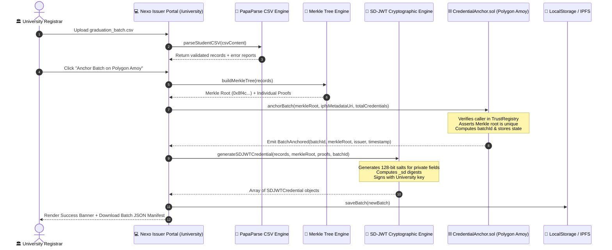
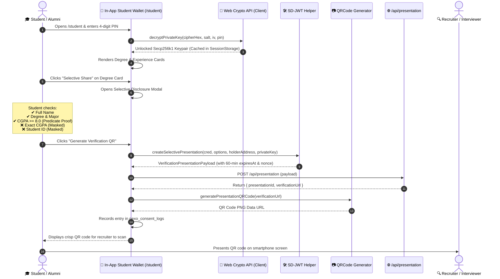
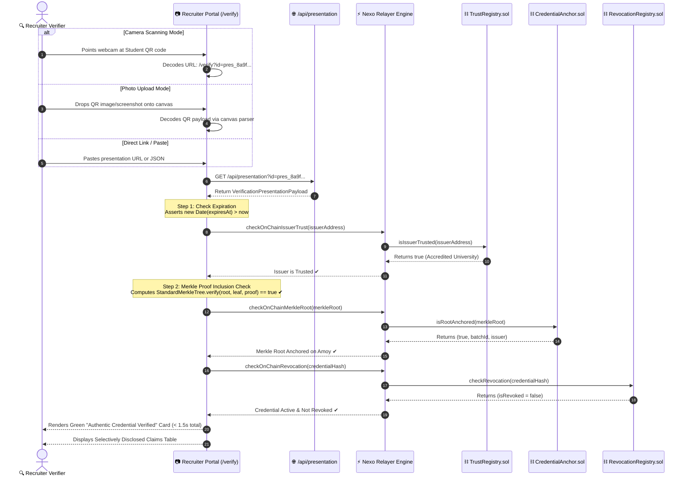
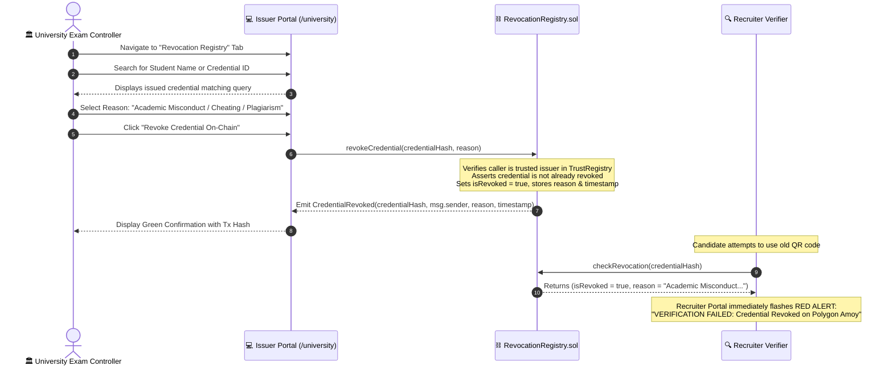

# 🔄 Workflows & Sequence Diagrams
## End-to-End Operational Lifecycle & Sequence Diagrams

---

## 1. Workflow 1: University Bulk Issuance & On-Chain Anchoring

This workflow describes how an accredited university (e.g., IIT Bombay) takes a graduation cohort CSV export, computes the Merkle tree, submits a single on-chain transaction to Polygon Amoy, and generates SD-JWT credentials for students.

---

## 2. Workflow 2: Student In-App Wallet & Selective Disclosure Presentation

This workflow explains how a student accesses their wallet without a seed phrase, views their credentials, selects which fields to disclose, and generates a dynamic, time-bound QR presentation token.

---

## 3. Workflow 3: Recruiter Multi-Mode Verification Flow

This workflow details what occurs when a corporate recruiter scans a candidate's QR code or uploads a screenshot during background verification.

---

## 4. Workflow 4: Instant Degree Revocation Flow

This workflow illustrates how an accredited university can immediately invalidate a degree due to academic misconduct, instantly blocking subsequent verifications across the globe.

